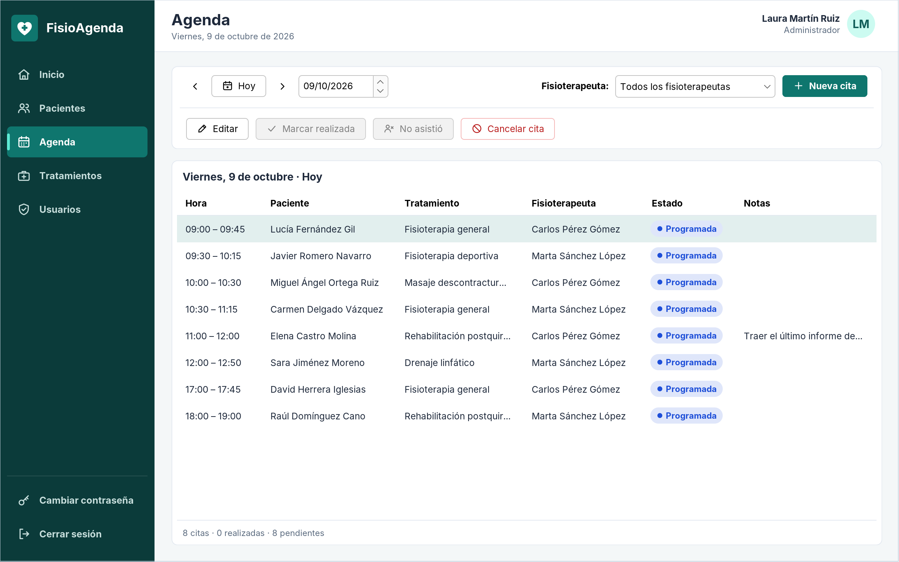

# FisioAgenda

Aplicación de escritorio en Java para la gestión de pacientes, citas e historial clínico en clínicas de fisioterapia pequeñas.
Proyecto Intermodular del CFGS Desarrollo de Aplicaciones Multiplataforma (Universae, curso 2026-2027). Autor: Ulises Gilio Kreiff.



## Funcionalidades
- Inicio de sesión con contraseñas cifradas (PBKDF2-HMAC-SHA256, 600 000 iteraciones y sal aleatoria), bloqueo temporal tras 5 intentos y cierre por inactividad.
- Tres roles con permisos distintos: Administrador, Fisioterapeuta y Recepción.
- Pacientes: alta, edición, búsqueda en vivo (sin distinguir tildes) y validación de DNI/NIE, teléfono y email.
- Agenda diaria por fisioterapeuta, detección de solapes, horario de la clínica y cálculo de huecos libres.
- Historial clínico con notas y escala visual analógica del dolor (EVA 0-10) con gráfico de evolución.
- Catálogo de tratamientos, gestión de usuarios y panel de inicio con indicadores.
- Interfaz adaptable (menú lateral que se pliega), atajos de teclado y animaciones.

## Requisitos
- Java 17 o superior (JRE o JDK).
- Para compilar: Maven 3.9.

## Ejecución
```
java -jar FisioAgenda.jar          # o doble clic en el JAR, ejecutar.bat (Windows) o ./ejecutar.sh (Linux/macOS)
```
En Windows, `crear_exe.bat` genera `FisioAgenda.exe` con el icono de la aplicación y su propio Java (usa `jpackage`, incluido en el JDK 17 o superior); queda en `build-exe\FisioAgenda\`.

La base de datos SQLite se crea en `~/.fisioagenda/fisioagenda.db` con datos de demostración. Ruta alternativa: `java -Dfisioagenda.db=ruta.db -jar FisioAgenda.jar`.

| Usuario | Contraseña | Rol |
|---|---|---|
| admin | Admin1234! | Administrador |
| fisio | Fisio1234! | Fisioterapeuta |
| fisio2 | Fisio1234! | Fisioterapeuta |
| recepcion | Recep1234! | Recepción |

## Compilación y pruebas
```
mvn clean package    # compila, ejecuta las 256 pruebas JUnit 5 y genera target/FisioAgenda.jar
mvn test             # solo pruebas
```

## Estructura
```
src/main/java/com/fisioagenda
├── Main.java            punto de entrada
├── model/               entidades del dominio
├── dao/                 interfaces de acceso a datos
│   └── sqlite/          implementación JDBC con SQLite
├── db/                  conexión, esquema y datos de demostración
├── security/            hash de contraseñas y sesión
├── service/             lógica de negocio y permisos por rol
├── util/                validaciones y formatos
└── ui/                  interfaz Swing (paneles, diálogos y componentes)
src/test/java            pruebas JUnit 5
docs/                    especificación técnica y capturas
```

## Tecnologías
Java 17 · Swing + FlatLaf 3.7.2 · SQLite (sqlite-jdbc 3.53.4.0) · JUnit 5.11.4 · Maven.
